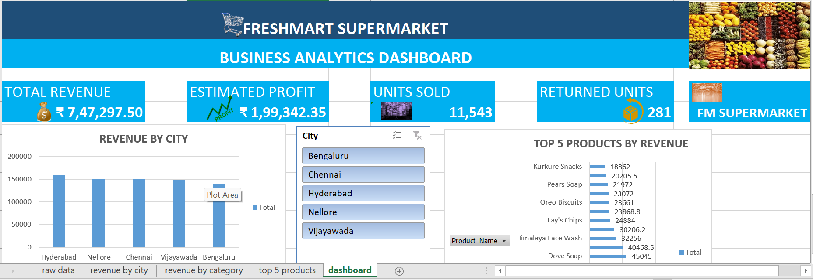

# Freshmart Excel Dashboard

Excel business analytics dashboard for a supermarket: KPIs, city revenue, top products.

## Dashboard Preview

## Business Questions
- Which city generates the most revenue?
- Which products earn the highest revenue?
- How many units were sold and returned?

## Key Metrics
- Total Revenue: ₹7,47,297.50
- Estimated Profit: ₹1,99,342.35
- Units Sold: 11,543
- Returned Units: 281

## Features
- KPI cards, Revenue by City chart, Top 5 Products chart
- Interactive slicers for City and Product

## Tools Used
Microsoft Excel (Pivot Tables, Pivot Charts, Slicers, Formulas)

## Challenges
Units Sold KPI showed a wrong value because the formula was written as `=SUM('raw data'!I2:441)`, which summed many columns. I fixed it to `=SUM('raw data'!I2:I441)` and verified it against the column total.

## Files
- `Freshmart_project.xlsx`: Excel workbook
- `dashboard.png`: dashboard screenshot
